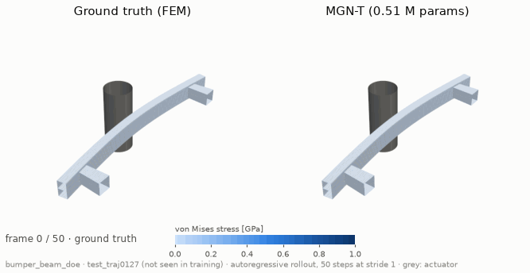

<div align="center">

# CrashDefNet

[](https://stofe94.github.io/crash-def-net/)
[](LICENSE)


[](https://doi.org/10.5281/zenodo.23575635)

<!-- --8<-- [start:what-is] -->
CrashDefNet (**Crash Deformation Network**) is a research tool that learns from crash
simulations how a structure deforms. A graph neural network is trained on the finite element
mesh of simulated runs and then predicts new runs step by step, each step starting from its
own previous prediction. CrashDefNet covers the whole way from the raw simulation data to
the evaluation and makes it quick to add and compare new network architectures.
<!-- --8<-- [end:what-is] -->



*Autoregressive rollout of a bumper beam against a pole, 50 steps from the undeformed state
to 100 ms, for a test run whose combination of geometry, impact velocity, shell thickness and
pole position was not part of training. Left: OpenRadioss simulation from
OpenRadioss-BumperBeam-DoE135 (CC BY-NC 4.0); right: MGN-T
([results](https://stofe94.github.io/crash-def-net/results/bumper-beam-doe/)). Colour: von
Mises stress.*

</div>

| Try it in the app | Try it on Google Colab | Documentation |
|:---:|:---:|:---:|
| [](https://stofe94.github.io/crash-def-net/getting-started/quick-start/)<br>After the [installation](https://stofe94.github.io/crash-def-net/getting-started/installation/), `python utils/app.py` opens a graphical interface in your browser, on your own machine, that leads through a first run without typing commands. | [](https://colab.research.google.com/github/stofe94/crash-def-net/blob/main/examples/quick_start/crashdefnet-quickstart.ipynb)<br>Without installation: a notebook runs export, training and rollout on Colab's free GPU and shows the prediction as an animation, in under 10 minutes. | [](https://stofe94.github.io/crash-def-net/)<br>The website holds the installation with requirements, GPU setup and raw data, the quick start, tutorials, guides, concepts and the full reference. |

## Highlights

- **Autoregressive by design.** The model carries a whole load case on its own predictions,
  with contact found anew in the predicted geometry at every step; training, model selection
  and metrics are built for it
  ([why autoregressive](https://stofe94.github.io/crash-def-net/concepts/overview/#why-autoregressive)).
- **Complete workflow.** From raw simulation data through training and rollout to evaluation
  against published results ([overview](https://stofe94.github.io/crash-def-net/concepts/overview/)).
- **New architectures, compared fairly.** In a lean core of about 6,100 lines of Python, a new
  architecture is one file and a few lines of config, compared under a fixed protocol with
  the included MeshGraphNets and MGN-T
  ([adding an architecture](https://stofe94.github.io/crash-def-net/guides/adding-an-architecture/)).

All highlights, with details: [purpose and highlights](https://stofe94.github.io/crash-def-net/purpose/#highlights).

<!-- --8<-- [start:citation] -->
## Citation

If you use CrashDefNet, please cite it (see [CITATION.cff](https://github.com/stofe94/crash-def-net/blob/main/CITATION.cff)). The DOI
covers all versions; [Zenodo](https://doi.org/10.5281/zenodo.23575635) also lists the
DOI of every single release.

```bibtex
@software{stocker_crashdefnet_2026,
  author  = {Stocker, Felix},
  title   = {CrashDefNet: Graph Neural Network Surrogates for Crash Simulation},
  year    = {2026},
  version = {1.1.0},
  doi     = {10.5281/zenodo.23575635},
  url     = {https://github.com/stofe94/crash-def-net}
}
```
<!-- --8<-- [end:citation] -->

## Contributing

Suggestions are welcome as issues or pull requests; see [CONTRIBUTING.md](CONTRIBUTING.md).

<!-- --8<-- [start:license] -->
## License

[GNU Affero General Public License v3.0](https://github.com/stofe94/crash-def-net/blob/main/LICENSE). Copyright 2026 Felix Stocker.

## Disclaimer

CrashDefNet is research software, made to be tested on industrial data and problems. Using
it takes expertise in simulation and machine learning, and every application needs its own
verification: it is not a qualified product, and its version number stands for the
completeness of the workflow. Its outputs are predictions of learned models; they complement
validated crash simulation and physical testing rather than replace them, and
safety-relevant design decisions based on them need independent verification. The software
is provided "as is", without warranty of any kind; see the
[License](https://github.com/stofe94/crash-def-net/blob/main/LICENSE).

Product names such as LS-DYNA and ParaView are trademarks of their respective owners;
CrashDefNet is an independent project and not affiliated with them.

## Author

**Felix Stocker**, data scientist (CAE, crash simulation, deep learning on 3D geometries)

- E-mail: [felix.stocker@sto-eng.de](mailto:felix.stocker@sto-eng.de)
- LinkedIn: [linkedin.com/in/felixstocker](https://www.linkedin.com/in/felixstocker)
- Skill profile: [stofe94.github.io/skill-profile](https://stofe94.github.io/skill-profile/)
<!-- --8<-- [end:license] -->
