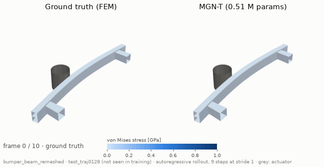

# CrashDefNet

<div align="center">

[](https://stofe94.github.io/crash-def-net/)
[](LICENSE)


[](https://doi.org/10.5281/zenodo.23575635)

</div>

**Graph neural network surrogates for crash simulation.** CrashDefNet learns from finite
element runs and predicts autoregressively, step by step on the mesh, how a structure
deforms. A complete, lean PyTorch research framework, from raw simulation data to
evaluation against published results, in which new architectures plug in quickly and are
compared under identical conditions.

| Try it in the app | Try it on Google Colab | Documentation |
|:---:|:---:|:---:|
| [](https://stofe94.github.io/crash-def-net/getting-started/quick-start/)<br>After the [installation](https://stofe94.github.io/crash-def-net/getting-started/installation/), `python utils/app.py` opens a graphical interface in your browser, on your own machine, that leads through a first run without typing commands. | [](https://colab.research.google.com/github/stofe94/crash-def-net/blob/main/examples/quick_start/crashdefnet-quickstart.ipynb)<br>Without installation: a notebook runs export, training and rollout on Colab's free GPU and shows the prediction as an animation, in under 10 minutes. | [](https://stofe94.github.io/crash-def-net/)<br>The website holds the installation with requirements, GPU setup and raw data, the quick start, tutorials, guides, concepts and the full reference. |

<div align="center">



*Autoregressive rollout of a bumper beam against a pole, a test run whose beam thickness and
pole position were not part of training, from 10 to 100 ms. Left: OpenRadioss simulation from
BumperBeamCrashExample (CC BY-NC 4.0); right: MGN-T
([results](https://stofe94.github.io/crash-def-net/results/bumper-beam/)). Colour: von Mises
stress.*

</div>

---

<!-- --8<-- [start:what-is] -->
## What is CrashDefNet?

CrashDefNet (**Crash Deformation Network**) is a deep-learning research tool for
**predicting structural deformation**: how each node of the simulation mesh moves and which
stress it carries. The application it is built for is **crash deformation**, and it is
developed specifically for **autoregressive prediction**: a model predicts one time step
from the current state, and each prediction becomes the input of the next, through the
whole load case. Contact is found anew in the predicted geometry at every step. This is the
foundation on which CrashDefNet is developed further
([why autoregressive](https://stofe94.github.io/crash-def-net/concepts/overview/#why-autoregressive)).

Beyond that, two things define it: it covers the **complete workflow** that an application
needs, and it stays **lean enough** that new model architectures can be integrated and
compared quickly.

This release (v1.0.0) is developed and evaluated on two datasets: DeepMind's open
**`deforming_plate`**, in which an actuator deforms plates of varying geometry, and
OpenRadioss runs of a **bumper beam hitting a pole**, a first real crash case
([deforming plate](https://stofe94.github.io/crash-def-net/results/deforming-plate/),
[bumper beam](https://stofe94.github.io/crash-def-net/results/bumper-beam/)). Reading
LS-DYNA and OpenRadioss runs and VTK time series, like the general data structures for crash
runs, is at an early stage of development
([verification status](https://stofe94.github.io/crash-def-net/concepts/graphs/#general-meshes-and-run-parameters)).
The release comes with two graph neural network architectures that run through the same
pipeline and can be compared directly:

- **MeshGraphNets (MGN)**: the original architecture for mesh-based simulation
  (Pfaff et al., ICLR 2021)
- **MeshGraphNet-Transformer (MGN-T)**: the current state of research (Iparraguirre
  et al., 2026). It combines local message passing with a physics-attention
  transformer as a global processor and targets the setting of crash: impact dynamics
  with self-contact and plasticity on large meshes
<!-- --8<-- [end:what-is] -->

## Highlights

- **Autoregressive by design.** Training, model selection and metrics are built for one task:
  carrying a whole load case on the model's own predictions, step by step
  ([why autoregressive](https://stofe94.github.io/crash-def-net/concepts/overview/#why-autoregressive)).
- **Complete workflow.** From raw simulation data through training and rollout to evaluation
  against published results ([overview](https://stofe94.github.io/crash-def-net/concepts/overview/)).
- **Quick to try, with a graphical app.** A browser page leads through a first run without
  typing commands; at an early stage and to be developed further, it can already train with
  any configuration ([the app](https://stofe94.github.io/crash-def-net/guides/app/)).
- **New architectures, compared fairly.** One file and a few lines of config, under a fixed
  protocol next to MeshGraphNets and the published numbers
  ([adding an architecture](https://stofe94.github.io/crash-def-net/guides/adding-an-architecture/),
  [deforming plate results](https://stofe94.github.io/crash-def-net/results/deforming-plate/)).
- **Physics in the graph.** Contact and self-contact are rebuilt from the predicted geometry
  at every step, only where bodies touch ([data and graphs](https://stofe94.github.io/crash-def-net/concepts/graphs/)).
- **MeshGraphNets and MGN-T.** Two architectures in one pipeline; MGN-T is implemented from
  the paper, with every assumption documented
  ([models](https://stofe94.github.io/crash-def-net/concepts/models/)).
- **OpenRadioss runs (early stage).** Read with their starter decks and verified on a real
  crash example, a bumper beam against a pole
  ([results](https://stofe94.github.io/crash-def-net/results/bumper-beam/),
  [tutorial](https://stofe94.github.io/crash-def-net/getting-started/bumper-beam/)); LS-DYNA runs and VTK time
  series are read too.
- **Built for large data.** Memory stays independent of the dataset size, up to a few hundred
  GB ([scaling](https://stofe94.github.io/crash-def-net/concepts/scaling/)).
- **Fully documented.** A website with tutorials, guides, concepts and a reference generated
  from the code ([documentation](https://stofe94.github.io/crash-def-net/)).
- **Lean, open and local.** Plain PyTorch and PyTorch Geometric, with a core of
  about 5,600 lines of Python, under AGPL-3.0; runs on your own machines, also on a CPU
  ([installation](https://stofe94.github.io/crash-def-net/getting-started/installation/#requirements)).

<!-- --8<-- [start:citation] -->
## Citation

If you use CrashDefNet, please cite it (see [CITATION.cff](https://github.com/stofe94/crash-def-net/blob/main/CITATION.cff)). The DOI
covers all versions; [Zenodo](https://doi.org/10.5281/zenodo.23575635) also lists the
DOI of every single release.

```bibtex
@software{stocker_crashdefnet_2026,
  author  = {Stocker, Felix},
  title   = {CrashDefNet: Graph Neural Network Surrogates for Crash Simulation},
  year    = {2026},
  version = {1.0.0},
  doi     = {10.5281/zenodo.23575635},
  url     = {https://github.com/stofe94/crash-def-net}
}
```
<!-- --8<-- [end:citation] -->

## Contributing

Suggestions are welcome as issues or pull requests; see [CONTRIBUTING.md](CONTRIBUTING.md).

<!-- --8<-- [start:license] -->
## License

[GNU Affero General Public License v3.0](https://github.com/stofe94/crash-def-net/blob/main/LICENSE). Copyright 2026 Felix Stocker.

## Disclaimer

CrashDefNet is research software, made to be tested on industrial data and problems. Using
it takes expertise in simulation and machine learning, and every application needs its own
verification: it is not a qualified product, and its version number stands for the
completeness of the workflow. Its outputs are predictions of learned models; they complement
validated crash simulation and physical testing rather than replace them, and
safety-relevant design decisions based on them need independent verification. The software
is provided "as is", without warranty of any kind; see the
[License](https://github.com/stofe94/crash-def-net/blob/main/LICENSE).

Product names such as LS-DYNA and ParaView are trademarks of their respective owners;
CrashDefNet is an independent project and not affiliated with them.

## Author

**Felix Stocker**, data scientist (CAE, crash simulation, deep learning on 3D geometries)

- E-mail: [felix.stocker@sto-eng.de](mailto:felix.stocker@sto-eng.de)
- LinkedIn: [linkedin.com/in/felixstocker](https://www.linkedin.com/in/felixstocker)
- Skill profile: [stofe94.github.io/skill-profile](https://stofe94.github.io/skill-profile/)
<!-- --8<-- [end:license] -->
