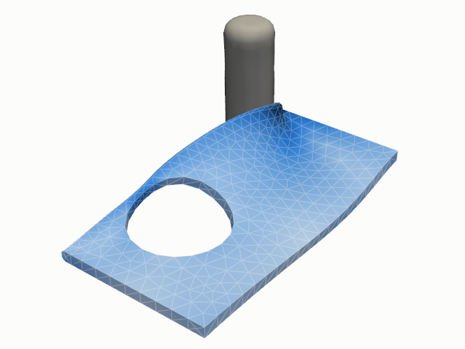
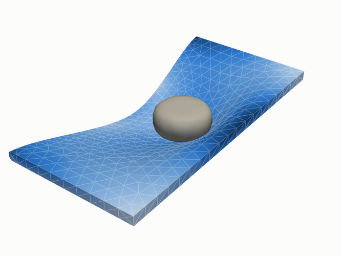
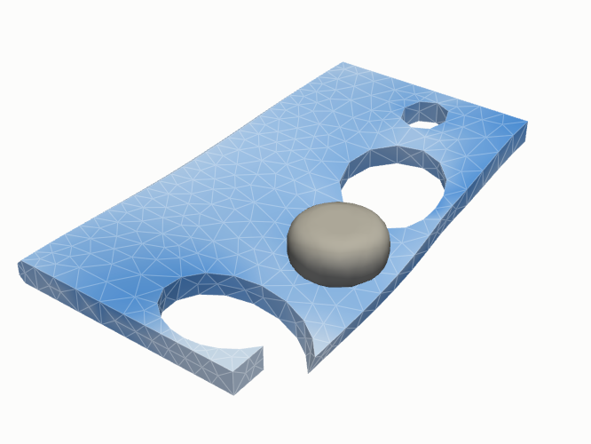
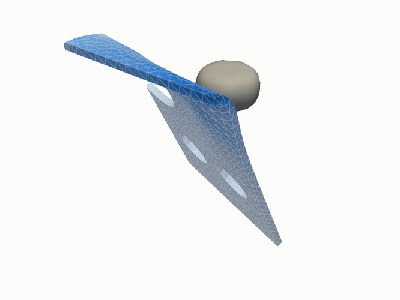
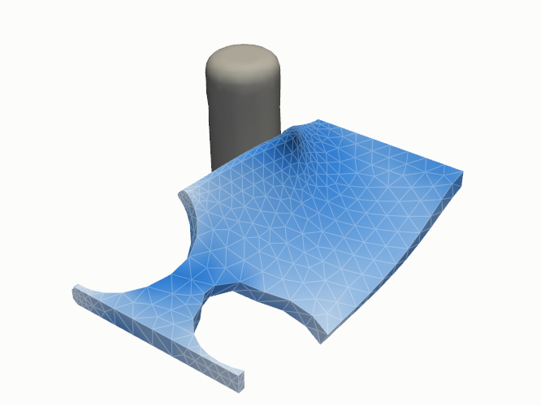
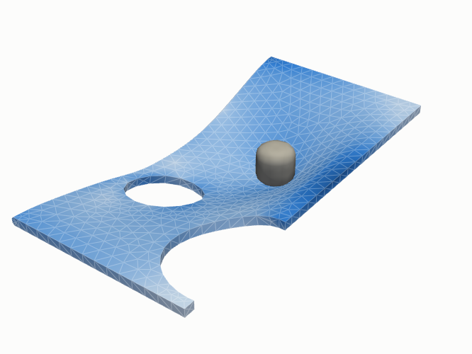

# Data and graphs

A model in CrashDefNet sees one time step of a simulation as a graph: the mesh nodes
with their features, the mesh edges and the contact edges. It predicts, per node, the
velocity to the next step and the stress there. This page describes the benchmark data,
how the graph of a time step is built, and what the readers of further raw formats add.
Every stage builds its graphs with the same functions
([`graph_features.py`](https://github.com/stofe94/crash-def-net/blob/main/dataset_preprocessor/graph_features.py)),
so export, training and rollout see identical graphs.

## The benchmark

DeepMind's `deforming_plate` (Pfaff et al., 2021) contains finite element simulations in
which an actuator impacts and deforms a hyperelastic plate: a simplified crash scenario
with contact and large deformations. Each trajectory has its own geometry and tetrahedral
mesh (~800–1,900 nodes in `test.tfrecord`) and 400 time steps: the actuator presses in
until step 360, then pulls back, and the plate springs back.

{ width="32%" }
{ width="32%" }
{ width="32%" }
{ width="32%" }
{ width="32%" }
{ width="32%" }

*Six plates of `test.tfrecord` (records 13, 18, 29, 38, 76 and 88, counted from 0) at
their deepest indentation, time step 360. Colour: von Mises stress, from light blue (0)
to dark blue (300 kPa and above); grey: the actuator.*

Per node and step it provides the world position and the von Mises stress, plus a node
type:

| Node type | Raw value | Meaning |
|---|---|---|
| normal | 0 | free plate nodes; their motion is predicted |
| actuator | 1 | scripted obstacle; motion is prescribed |
| clamped | 3 | fixed boundary nodes |

The dataset is published by DeepMind with the
[MeshGraphNets release](https://github.com/google-deepmind/deepmind-research/tree/master/meshgraphnets)
and is not part of this repository; it is downloaded directly from DeepMind (see
[installation](../getting-started/installation.md#raw-data)). DeepMind states no explicit
license for the datasets (the Apache 2.0 license of that repository covers its code), so
the terms of the source apply, in particular for commercial use.

## Graph per time step t

Features follow MeshGraphNets (Pfaff et al., 2021, App. A.1); the dimensions are those of
`deforming_plate`, other data add [columns](#general-meshes-and-run-parameters):

| | Features | Dim. |
|---|---|---|
| Nodes `x` | one-hot node type (normal / actuator / clamped) + next actuator velocity xₜ₊₁ − xₜ (0 elsewhere) | 6 |
| Mesh edges `edge_attr` | uᵢⱼ, ‖uᵢⱼ‖ (rest configuration) + xᵢⱼ, ‖xᵢⱼ‖ (current configuration) | 8 |
| World edges `world_edge_attr` | xᵢⱼ, ‖xᵢⱼ‖ for all node pairs with ‖xᵢ − xⱼ‖ < r_W (`deforming_plate`: 0.03 m) that are not mesh neighbours (paper; other variants below) | 4 |
| Target `y` | velocity xₜ₊₁ − xₜ (3) + stress σₜ₊₁ (1); other raw data: its [result fields](#general-meshes-and-run-parameters) | 4 |
| `loss_mask` | all nodes except the actuator | – |

Relative vectors point from sender to receiver. Mesh edges come from the six edges of
every tetrahedron, in both directions (for other cell types see
[below](#general-meshes-and-run-parameters)). World edges model contact: they connect nodes
that are close in the deformed configuration but not neighbours in the mesh, and they
are rebuilt whenever the positions change (noise during training, every rollout step).
The radius search computes the distances directly: a dense distance matrix for graphs up
to 2,500 nodes, a cell list (spatial grid) above, with identical results; it scales to
crash meshes: 300,000 nodes at the node spacing of `deforming_plate` in ~2 s on a
desktop CPU, where a distance matrix would take 360 GB.

The search joins nodes, with one radius for the whole model. A contact partner with a
coarser mesh than the radius, e.g. a rigid pole or barrier, can touch a structure between
its nodes, where no node pair comes within r_W: that contact then gets no world edge. The
radius has to suit the coarsest contact partner; a finer contact search is planned
([roadmap](../about/roadmap.md)).

All feature groups are standardized with the statistics in `normalizer.json`. The
one-hot columns keep mean 0 / std 1 and pass through unchanged.

### World edge variants (`[model] world_edges`)

Which pairs within the radius r_W get a world edge is a model setting, so the variants
can be compared on the same dataset:

| `world_edges` | Pairs within r_W that get a world edge |
|---|---|
| `"all"` (default, paper) | all pairs that are not mesh neighbours (Pfaff et al. 2021, Sec. 3.1 on p. 4) |
| `"contact"` | only pairs of different bodies (connected parts of the mesh) |
| `"self_contact_aware"` | pairs not connected through the material: contact between bodies plus self-contact, without the near neighbours inside a body. Connected: the shortest path along the mesh edges of the rest state is shorter than `world_edge_exclude_distance` × r_W (default 2) |

On `deforming_plate`, with r_W = 0.03 m and a median mesh edge length of about 0.018 m,
the paper rule also links nodes of the same body two or three mesh edges apart; most world
edges there are actuator ↔ actuator or plate ↔ plate pairs that exist already at rest, only a
few percent the actual contact. The actuator acts on the plate only through world edges.

- `contact` suits bodies that touch but do not fold onto themselves; self-contact cannot
  be represented.
- `self_contact_aware` also keeps pairs of the same body that are far apart along the
  mesh, e.g. the folds of a crushed crash structure. It measures the path through the
  material, not the number of mesh edges, so it holds where a mesh is locally refined.
  On `deforming_plate` the result is close to `contact`: no plate folds onto itself, so
  self-contact is not exercised there, and the few world edges inside a plate cross
  narrow gaps in the plate that exist already at rest.
- The comparison protocol compares new architectures with MeshGraphNets on
  `self_contact_aware`; the published results of the paper, with `all`, are the
  original reference ([baselines](../guides/comparison-protocol.md#baselines)).

Bodies and excluded pairs are computed once per mesh (the path rule per rest geometry)
and stored in every sample, so position noise and rollout rebuild the same variant; the
rollout takes the variant from the checkpoint. The normalizer statistics of the world
edges come from the export (all pairs) and serve every variant.

### Components and contact rules

Raw data with parts (LS-DYNA and OpenRadioss runs, VTK time series) give every node a
**component**: the part it belongs to, under the part's name (d3plot: its title); a node shared by
several parts, e.g. at a weld, belongs to the one that appears first. The components are
stored with the export (`component_names` in `metadata.json`) and do not enter the models, which see the role of a node (its node
type) and its properties (static node features), not its name, so that a model is not
tied to the parts of one dataset.

**Contact rules** (`--contact-pairs` of the export) list the pairs of components that can
touch, e.g. `plate:impactor plate:plate` (contact with the impactor and self-contact of
the plate). World edges then only join nodes of a listed pair, in every variant above:
the rule removes pairs that the radius would join but that cannot interact physically,
e.g. parts that are separated by a third one or not modelled in contact. Without rules
every pair can get a world edge. The rules are part of the export, so training, noise and
rollout apply the same ones.

## General meshes and run parameters

!!! warning "Verification status"
    - **Verified on `deforming_plate`.** Training, rollout and the comparison with the
      papers.
    - **OpenRadioss runs: early stage, verified on a real crash example.** Runs of a bumper
      beam against a pole, end to end from the raw data to the rollout
      ([results](../results/bumper-beam.md), [tutorial](../getting-started/bumper-beam.md)).
      Through it: the d3plot reader with the OpenRadioss starter deck, a shell mesh with
      spot welds and ties, components with roles from an export config, a free rigid body,
      contact edges to a rigid pole, the shell thickness as static node feature, values
      that nodes do not have, and units other than SI.
    - **LS-DYNA runs, VTK time series and further data structures: early stage, tested on
      synthetic and converted data.** The keyword deck of LS-DYNA (materials, boundary
      conditions, initial velocity, rigid walls), run parameters, result fields besides the
      stress, contact rules and the VTK reader go through every stage; the test suite checks this on small synthetic datasets
      and on runs converted from `deforming_plate`. Real datasets with these structures
      follow.

Raw data other than `deforming_plate` ([OpenRadioss runs](../guides/openradioss.md),
[LS-DYNA runs](../guides/ls-dyna.md),
[VTK time series](../guides/vtk.md)) may contain other cells, other result fields,
parameters per run, static node properties and rigid walls. The dataset takes all of
them:

| | |
|---|---|
| Result fields | the quantities per node and frame that the model predicts besides the velocity: in `deforming_plate` the von Mises stress, in other data any number of them under their own names, e.g. stress and plastic strain, or none (VTK: `--stress-field`, `--fields`; LS-DYNA: the stress, plus `--fields plastic_strain thickness`). Each is a target column; with `--history 1` its value at t is an input `<name>_prev`. Metrics are reported per field; the rollout metrics of the stress only when the data has one |
| Cells | lines, triangles, quadrilaterals, tetrahedra, pyramids, wedges and hexahedra, also mixed, stored in VTK node order with their VTK cell types. Mesh edges come from the edges of every cell; the rollout writes the cell types into the `.vtu` files |
| Run parameters | `globals.json` next to a run's `d3plot` or VTK files, e.g. `{"impact_velocity": 15.6, "thickness_scale": 1.1}`. Every run of a dataset must have the same names. They are the global input `u` of a graph (one row per graph), standardized over the train trajectories, and both architectures then get a [global block](models.md#global-block-run-parameters). |
| Static node features | properties of a node that stay over the run: `thickness` (shell thickness at the first state) and `initial_velocity_x/y/z` (from `*INITIAL_VELOCITY*`); with `--static-fields` the material properties of the deck, `density`, `youngs_modulus`, `poisson_ratio`, `yield_stress`, the mean over the elements around a node (VTK: point or cell fields). Standardized over the train nodes; every run of a dataset must have the same ones. A node without the feature, e.g. without a thickness at solids and beams, has no value and not a 0: it stays empty in the dataset (NaN) and counts in no statistics. The model gets the neutral value 0 after standardization and a column `<name>_given`, 1 where the node has a value, passed on as it is; this column exists only if nodes lack the feature, and follows it when a training chooses its features. The same holds for a result field, e.g. no stress at beams: with `--history 1` its `<name>_prev` input is neutral and `<name>_given` exists as well. Such a target counts neither in the loss nor in any metric; the velocity of the node still does |
| Rigid walls | stationary planar walls (`*RIGIDWALL_PLANAR`) and cylinders (`/RWALL/CYL`) as the last 4 node feature columns: signed distance to the nearest wall, clipped to ±5 × contact radius, and its unit normal, radial at a cylinder (no wall: distance 5 × contact radius, normal 0). They depend on the positions and are rebuilt with the world edges (noise, scheduled sampling, every rollout step) |
| Node types | the three types stay: crash parts map onto them as deformable → normal; rigid (`*MAT_RIGID`) and prescribed motion (`*BOUNDARY_PRESCRIBED_MOTION_*`) → actuator, whose motion is taken as given input; fixed (`*BOUNDARY_SPC_*`) → clamped; [free rigid parts](#free-rigid-parts) → normal ([details](../guides/ls-dyna.md#the-d3plot-reader)). In VTK data `--actuator-parts` names parts whose motion is given (e.g. a rigid impactor), `--clamped-parts` fixed ones, the rest deform |
| Components | the parts of d3plot and VTK raw data, any number under their own names, with [contact rules](#components-and-contact-rules) between them |

Column order of `x`: node type, `bc_velocity`, history columns, static node features, wall
columns. How all of
this is stored: [file formats](../reference/file-formats.md#dataset-folder). A training can
use a part of the result fields, run parameters and static node features:
[choose the features](../guides/training.md#choose-the-features).

Run parameters are inputs only: global targets (e.g. a sensor acceleration or a wall
force) would need a global output of the models, which is not implemented yet.

These structures carry the physics of a crash run into the graph, each where it acts: a
property of a node at the node, a parameter of the whole run in `u`, a contact rule on
the world edges. Run parameters and static node features are therefore quantities that
influence the deformation, e.g. the impact velocity or a thickness
([design principles](overview.md#design-principles)); further structures follow the same
rule ([roadmap](../about/roadmap.md)).

### Free rigid parts

A rigid part is an actuator by default: its motion is taken from the run as given
input, which is right for a part that is fixed or driven by a boundary condition, such
as a fixed pole or a scripted impactor. A rigid part whose motion results from the crash,
such as a barrier with mass or a pole that gives way, can be predicted instead, if the
runs hold its motion (d3plot and VTK raw data do):
`export.py --free-rigid-parts NAME ...` (d3plot: rigid parts without prescribed motion,
by title), or the role `free_rigid` in an
[export config](../guides/export.md#define-the-dataset-in-a-config-file).

- Their nodes are normal nodes: the model predicts their velocity, and they are part of
  the loss and of the metrics.
- The rollout moves each free rigid part as a rigid body: from the predicted
  velocities of its nodes it takes the mean translation and the rotation about its
  centre that fits them best (least squares), and applies that rotation exactly. The
  part keeps its shape over the whole rollout, whatever the model predicts for single
  nodes; contact with it works through the world edges as for any other part.
- `metadata.json` and the `info` table list them as `rigid_bodies`; every sample holds
  `rigid_body`, the index of the body of every node (−1 for the others).

The option changes which motion is an input and which a prediction, so exports with and
without it are different datasets; the models of both architectures need no change.

## Optional history (`--history 1`, not in the paper)

Appends `velocity_x/y/z_prev` (= xₜ − xₜ₋₁) and `stress_prev` (= σₜ) to the node
features (for `deforming_plate` 10 instead of 6 columns; 9 with `--no-prev-stress`); with other result fields
one `<name>_prev` per field, which `--no-prev-stress` leaves out as well. Only with this layout do
`residual_target`, `[scheduled_sampling]` and `stress_noise_std` take effect. The first
frame of each trajectory, the undeformed state, is a sample as well: its velocity input
is the initial velocity of the deck over one frame interval (`*INITIAL_VELOCITY*`,
`/INIVEL`), at rest without one, so that a rollout starts from it alone. The layout is
stored in `metadata.json` and the database; model, training and rollout pick it up
automatically.
