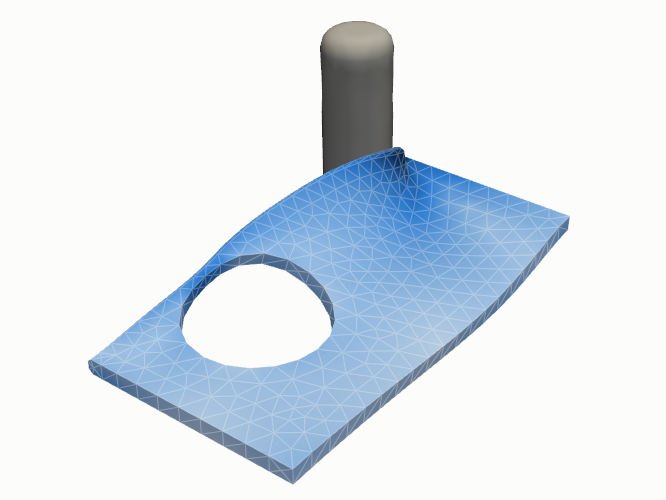
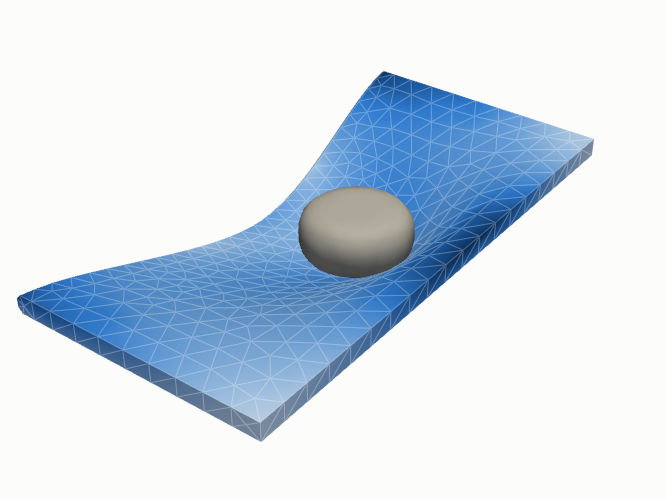
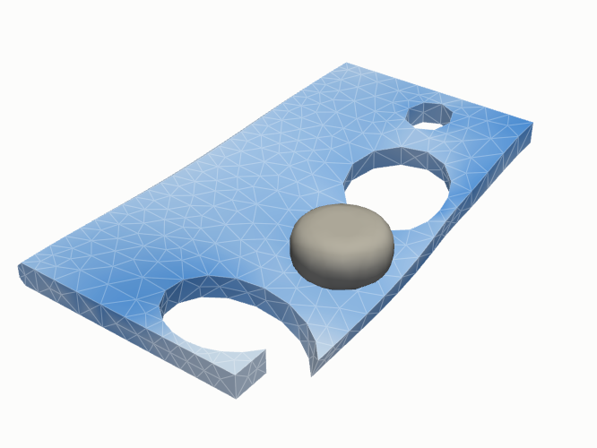
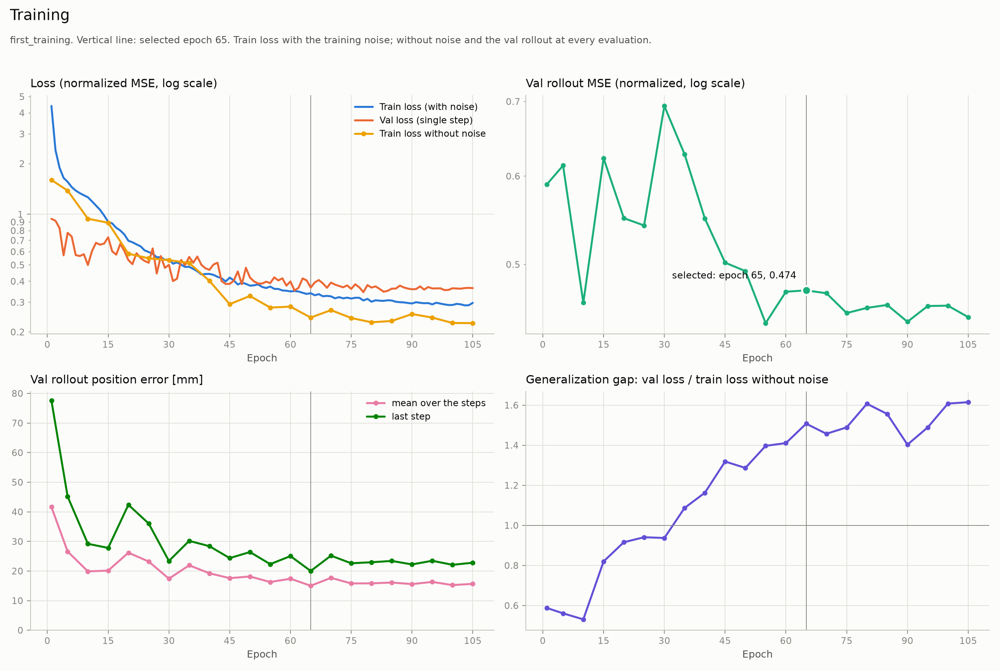

# Tutorial: first training

A first real training: MGN-T in the size of its paper learns from 28 plates and then predicts
4 plates it has never seen. The dataset is still small, but large enough for a result that can
be analysed. On a GPU it takes about an hour; the GPU times on this page were measured on an
NVIDIA RTX A4000 (16 GB). A CPU also works, but takes much longer.

Needs the [installation](installation.md) and `meta.json` and `test.tfrecord`
([raw data](installation.md#raw-data)). The configs of all steps are in
[`examples/deforming_plate/`](https://github.com/stofe94/crash-def-net/tree/main/examples/deforming_plate).

{ width="32%" }
{ width="32%" }
{ width="32%" }

*Three plates of the dataset at their deepest indentation: an actuator (grey) presses into a
plate of its own geometry. Colour: von Mises stress. More on the data:
[the benchmark](../concepts/graphs.md#the-benchmark).*

## 1. Dataset

```bash
python -m dataset_preprocessor.export --config examples/deforming_plate/export.toml
```

[`export.toml`](https://github.com/stofe94/crash-def-net/blob/main/examples/deforming_plate/export.toml) takes 40 plates of `test.tfrecord` at every 8th time step:
28 for training, 8 for validation, 4 for the test (~13 s, ~48 MB), and writes them to
`data/deforming_plate_s8_t40/`.

## 2. Config

[`train.toml`](https://github.com/stofe94/crash-def-net/blob/main/examples/deforming_plate/train.toml) is the quick start config [`examples/quick_start/train.toml`](https://github.com/stofe94/crash-def-net/blob/main/examples/quick_start/train.toml) with these settings
changed:

```toml
[data]
data_dir               = "data/deforming_plate_s8_t40"
num_dataloader_workers = 3       # on a CPU: 0

[model.mgn_t]
latent_size       = 80
token_dim         = 48
num_pre_mp_steps  = 2
num_post_mp_steps = 2
tau_init          = 0.31
pe_frequencies    = 4

[training]
epochs = 120

[training.rollout_validation]
every_n_epochs = 5

[training.early_stopping]
min_epochs = 50

[checkpointing]
checkpoint_dir = "checkpoints/first_training"
save_every     = 20
```

This gives MGN-T with 0.51 M parameters, the size of its paper
([configuration](../results/deforming-plate.md#mgn-t-configuration)). What the settings do:
[configuration reference](../reference/configuration.md). For own experiments, copy the file
and adapt it.

## 3. Train

```bash
python train/train.py --config examples/deforming_plate/train.toml
```

An epoch takes about 40 s, at most 120 epochs about 1 h 20 min. Every 5 epochs the model
predicts the validation plates, and the training ends early when it stops improving
([training](../concepts/training.md#model-selection-and-early-stopping)). The selected model
is `checkpoints/first_training/best_model.pt`.

## 4. Predict

```bash
python predict/rollout.py --config examples/deforming_plate/rollout.toml
```

With [`rollout.toml`](https://github.com/stofe94/crash-def-net/blob/main/examples/deforming_plate/rollout.toml) the model predicts the 4 test plates from the first time
step on, each step from its own previous prediction. In the same call the run is evaluated and
the plate at the median of the position error is animated:

- `rollouts/<time>_first_training_best_model_ep<epoch>_test/`: the metrics per plate and a
  `.vtu` per step for ParaView
- `evaluations/<time>_first_training_evaluation/evaluation.md`: training, single step and
  rollout, with figures ([evaluate a run](../guides/evaluation.md#evaluate-a-run))
- `evaluations/<time>_animation/`: the animation

## 5. Look at the result

The report shows the course of the training:



*Losses, validation rollout and generalization gap over the epochs; the vertical line marks
the selected model.*

The errors over the whole rollout on the 4 test plates:

| Test plate | Position error [mm] | Stress error [kPa] |
|---|---|---|
| 36 | 10.6 | 9.16 |
| 37 | 5.92 | 19.5 |
| 38 | 70.0 | 61.7 |
| 39 | 4.53 | 21.1 |
| **Median** | **8.27** | **20.3** |
| All together (pooled) | 35.4 | 34.3 |

Plate 38 stands out: it deforms by up to 490 mm, more than any training plate (at most 301 mm,
median 76 mm), so the model has to extrapolate. This one plate dominates the pooled value,
so the median is the better guide for a typical plate
([metrics](../concepts/metrics.md#rollout-metrics)).

These values come from the model of a run of this configuration with release v0.3.0, rolled
out with the current version. That run still used older rules for choosing the contact edges
and for ending the training (it stopped after 105 epochs and selected epoch 65), so a new
training gives similar, not identical numbers.

## Next steps

- [Tutorial: bumper beam](bumper-beam.md): a real crash case, from
  the OpenRadioss runs to the prediction.
- [Compare architectures](../guides/compare-architectures.md): two
  architectures on a larger dataset, next to the published values.
- [Train a model](../guides/training.md) and [evaluate a run](../guides/evaluation.md#evaluate-a-run):
  all options and outputs.
