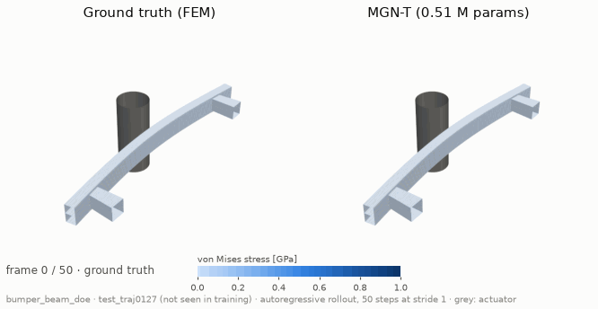

# CrashDefNet

--8<-- "README.md:what-is"

What CrashDefNet is for and what it offers: [purpose and highlights](purpose.md).



*Autoregressive rollout of a bumper beam against a pole, 50 steps from the undeformed state
to 100 ms, for a test run whose combination of geometry, impact velocity, shell thickness and
pole position was not part of training. Left: OpenRadioss simulation from
OpenRadioss-BumperBeam-DoE135 (CC BY-NC 4.0); right: MGN-T
([results](results/bumper-beam-doe.md)). Colour: von Mises stress.*

<div class="grid cards" markdown>

- **Getting started**

    ---

    Run the whole workflow in minutes, install CrashDefNet and follow the tutorials.

    [Quick start](getting-started/quick-start.md) ·
    [Installation](getting-started/installation.md) ·
    [First training](getting-started/first-training.md) ·
    [Bumper beam](getting-started/bumper-beam.md)

- **Guides**

    ---

    Use the app, export and explore datasets, read OpenRadioss runs, train, roll out,
    evaluate, add an architecture.

    [The app](guides/app.md) · [Export](guides/export.md) · [Explore data](guides/explore-data.md) ·
    [OpenRadioss runs](guides/openradioss.md) · [Train](guides/training.md) ·
    [Roll out](guides/rollout.md) · [Evaluate](guides/evaluation.md) ·
    [Add an architecture](guides/adding-an-architecture.md)

- **Concepts**

    ---

    How the graphs, models, training and metrics work, and how the data scale.

    [How CrashDefNet works](concepts/overview.md) · [Data and graphs](concepts/graphs.md) ·
    [Models](concepts/models.md) · [Scaling](concepts/scaling.md)

- **Reference**

    ---

    Every command line option, config key and file format.

    [Command line](reference/cli.md) · [Configuration](reference/configuration.md) ·
    [File formats](reference/file-formats.md) · [Glossary](reference/glossary.md)

</div>

## The CrashDefNet app

A graphical interface: one command opens a page in your browser, on your own machine, that
leads through a first run in minutes without typing commands ([the app](guides/app.md)).

```bash
python utils/app.py
```

Needs the [installation](getting-started/installation.md). Without installation, the quick
start runs on Google Colab ([quick start](getting-started/quick-start.md)).

## Results

MGN-T on a real crash example, OpenRadioss runs of a bumper beam against a pole. On a design
of experiments of 135 runs, with geometry, velocity, thickness and pole position varied, from
the undeformed state on 14 unseen runs, next to the results of Akhare et al.:
[bumper beam DoE](results/bumper-beam-doe.md). Over the whole impact on 7 unseen runs with
varied beam thickness and pole position: [bumper beam](results/bumper-beam.md).

MGN-T and MeshGraphNets under the same protocol on 20 unseen test geometries of
DeepMind's original splits, made with an earlier version of CrashDefNet:
[deforming plate results](results/deforming-plate.md). The numbers are preliminary and not a
reproduction of the papers.
