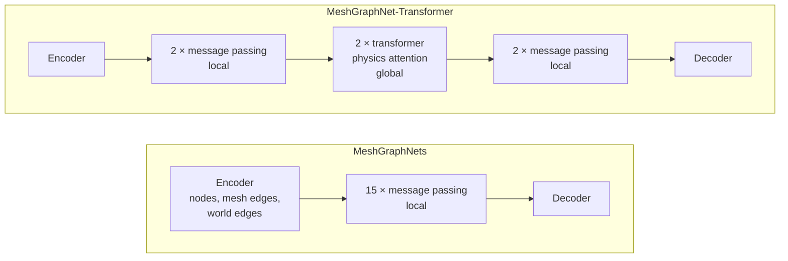

# Models

Both architectures take the same graph (nodes, mesh edges, world edges; see
[data.md](data.md)) and return the same output: the normalized velocity and stress per
node for the next time step. Run parameters reach them as constant node feature columns;
global inputs, a global state and global outputs are not implemented yet (open points:
[data.md](data.md#general-meshes-and-run-parameters)). The architecture is
selected in the config:

```toml
[model]
architecture = "meshgraphnets"   # or "mgn_t"
```



## MeshGraphNets (`meshgraphnets`)

[`models/meshgraphnets.py`](../models/meshgraphnets.py), after Pfaff et al., *Learning
Mesh-Based Simulation with Graph Networks* (ICLR 2021), Encode-Process-Decode with two
edge sets:

- **Encoder:** separate MLPs for nodes, mesh edges and world edges, each followed by
  LayerNorm
- **Processor:** L blocks with their own weights. Per block
  - e′ᴹᵢⱼ = fᴹ(eᴹᵢⱼ, vᵢ, vⱼ) and e′ᵂᵢⱼ = fᵂ(eᵂᵢⱼ, vᵢ, vⱼ)
  - v′ᵢ = fⱽ(vᵢ, Σⱼ e′ᴹᵢⱼ, Σⱼ e′ᵂᵢⱼ)
  - residual connections: v ← v + v′, e ← e + e′; every f is an MLP + LayerNorm
- **Decoder:** MLP without LayerNorm on the final node latents
- All MLPs: ReLU, `num_mlp_layers` hidden layers of width `latent_size`

Paper size: `latent_size = 128`, `num_message_passing_steps = 15`, 2 hidden layers
(3.85 M parameters with mesh and world edges). For a CPU run, `config.example.toml`
holds 64 / 8 in `[model.meshgraphnets]`.

The weakness that MGN-T addresses: information travels one edge per message passing
step. On large meshes a deep stack is needed for effects to reach distant nodes
("under-reaching"), which makes the model large and slow.

## MeshGraphNet-Transformer (`mgn_t`)

[`models/mgn_t.py`](../models/mgn_t.py), after Iparraguirre et al.,
*MeshGraphNet-Transformer: Scalable Mesh-Based Learned Simulation for Solid Mechanics*
(2026, [arXiv:2601.23177v4](https://arxiv.org/abs/2601.23177v4); table, section and
page numbers in this repository refer to version 4 unless they name version 3).
CrashDefNet's MGN-T is an independent implementation based on the paper; it is not
affiliated with or endorsed by the authors.

Instead of 15 message passing steps, MGN-T uses

1. **2 local message passing steps** (same blocks as MeshGraphNets) that encode the
   neighbourhood of every node,
2. **2 transformer blocks with physics attention** as a global processor, which
   update all nodes of the simulated structure at once; the actuator acts through the
   contact edges of the local steps and takes no tokens (paper Sec. 3.3),
3. **2 further local steps** that refine the result,

followed by the decoder. MLPs use LeakyReLU and LayerNorm (paper Sec. 3.2).

**Physics attention** (Transolver, Wu et al. 2024, with the eidetic states of
Transolver++, Luo et al. 2025) avoids attention over all N nodes, which would cost
O(N²):

```
tau  = tau_0 + Linear(x)                            learned temperature
w    = Softmax((Linear(x) - log(-log(eps))) / tau)   slice weights (N × P)
z_j  = Σ_i w_ij x_i / Σ_i w_ij                       slicing: nodes -> P tokens
z'   = Softmax(Q Kᵀ / √c) V                          attention over P tokens only
x'_i = Σ_j w_ij z'_j                                 de-slicing: tokens -> nodes
```

With P tokens the cost grows linearly with the number of nodes. A sinusoidal positional
encoding of the undeformed structure (`mesh_pos`, without the actuator) is added before
the transformer.

Paper settings for deforming_plate (Sec. 5.1 and Tab. 2, pp. 6–7): 2 + 2 message
passing steps, 2 transformer blocks, 4 heads, **16 tokens**, ~0.5 M parameters,
τ₀ = 1.0; 25 epochs with batch 32, cosine schedule from 1e-4 to 1e-6. The defaults here
(widths 64-32-64, 128 tokens) come from version 3 and give 0.32 M parameters; the
[results](results.md#mgn-t-configuration) use widths 80-48-80 and 16 tokens, the paper's
size of 0.51 M.

### Assumptions where the paper leaves gaps

No code has been published for MGN-T. Where the paper does not specify a detail, the
following choices were made. Each one is marked in the code:

1. **De-slicing** ("projects P back onto N" in the paper) uses the same slice weights
   as slicing, as in Transolver.
2. **Gumbel noise** −log(−log(ε)) is drawn with ε ~ U(0, 1), the standard form of the
   Gumbel trick, and only during training (the paper states ε ~ N(0, 1)).
3. **Temperature** τ is kept positive with softplus; otherwise it could reach zero.
   The paper writes τ = τ₀ + Linear(x) with τ₀ = 1.0; with softplus the initial τ is
   `tau_init` + ln 2 (≈ 1.19 for the default 0.5).
4. **Positional encoding:** 3 axes × sin/cos × `pe_frequencies` frequencies
   (2⁰ … 2^(F−1)), normalized per graph to [0, 1]. The paper cites Vaswani et al. and
   gives no dimension.
5. **Widths "64-32-64"** (version 3 only) are read as: message passing 64, transformer 32,
   refinement 64.
6. **Residual connection** around the transformer stage and pre-norm blocks (standard,
   not described in the paper).
7. **Decoder without LayerNorm** (as in MeshGraphNets); normalizing the output would
   destroy the magnitude of the prediction.
8. **Batches may mix trajectories:** slicing and attention run per graph. The paper
   batches the snapshots of one trajectory.

### Parameters (`[model.mgn_t]`)

| Key | Default | Meaning |
|---|---|---|
| `latent_size` | 64 | width of the message passing stages |
| `token_dim` | 32 | width of the transformer |
| `num_tokens` | 128 | physical tokens P (paper, deforming_plate: 16) |
| `num_heads` | 4 | attention heads |
| `num_transformer_blocks` | 2 | transformer blocks |
| `num_pre_mp_steps` / `num_post_mp_steps` | 2 / 2 | local steps before / after the transformer |
| `pe_frequencies` | 8 | frequencies of the positional encoding (not in the paper) |
| `ffn_ratio` | 4 | hidden width of the feed forward block / `token_dim` (not in the paper) |
| `tau_init` | 0.5 | τ₀ under softplus (paper: τ₀ = 1.0 without it, see assumption 3) |
| `transformer_nodes` | `structure` | nodes of the global stage: `structure` (paper: without the actuator) or `all` (every node, as up to v0.2.0 and for checkpoints without the key) |
| `num_mlp_layers` / `aggregation` | 2 / `sum` | hidden layers of every MLP and aggregation of the messages (`sum` \| `mean`); one setting shared with `[model.meshgraphnets]` |

## Optional residual target (`residual_target = true`)

[`models/residual.py`](../models/residual.py) wraps either architecture. The network
then predicts the normalized *change* of every target that has a matching `*_prev`
input, instead of its absolute value. This needs an export with `--history 1` (not in
the paper). A freshly initialized network then starts at the "copy the previous value"
baseline.

## Adding an architecture

A new architecture plugs into the same pipeline in four small steps; see
[adding-an-architecture.md](adding-an-architecture.md).

## Checkpoints

A checkpoint holds the model's `state_dict`, the training config, the dataset metadata
and the normalizer statistics; `train.trainer.load_trained_model` rebuilds the model from
it (older checkpoints without normalizer read `normalizer.json` of the dataset folder).
The attribute names of the modules are `state_dict` keys: renaming them breaks existing
checkpoints.
