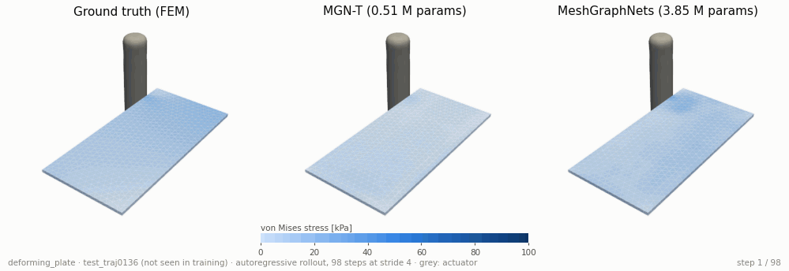

# First results (v0.4.0, preliminary)

The two architectures in CrashDefNet, **MeshGraphNets (MGN)** and
**MeshGraphNet-Transformer (MGN-T)**, on DeepMind's `deforming_plate`, next to the values
of the papers. The runs are deliberately small: a subset of the data, one GPU, a few
hours. Both models share data, seed, budget and recipe of the
[comparison protocol](comparison-protocol.md) and the contact edges
(`self_contact_aware`): MGN-T as in arXiv v4 ([configuration](#mgn-t-configuration)),
MeshGraphNets in paper size as the [comparable baseline](comparison-protocol.md#baselines).
The runs show that the pipeline works end to end and how the architectures behave; they
are **not** a reproduction of the papers' numbers.



*Autoregressive rollout of test trajectory 136, a geometry the models never saw during
training. Colour: von Mises stress, same scale in all three panels. Grey: the actuator, whose motion is prescribed. Made
with [`utils/animate_rollout.py`](../utils/animate_rollout.py) (see
[Reproducing](#reproducing)).*

## Setup

| | MGN-T (paper configuration) | MeshGraphNets (comparable baseline) |
|---|---|---|
| Architecture | 2 + 2 message passing steps, 2 transformer blocks over the plate nodes, 16 physics tokens, widths 80 / 48 ([configuration](#mgn-t-configuration)) | 15 message passing steps, latent 128 |
| Contact edges | between bodies and for self-contact (`self_contact_aware`, paper v4) | the same (paper: all pairs within the contact radius, `all`; Pfaff et al. 2021, Sec. 3.1 on p. 4) |
| Parameters | **0.51 M** | 3.85 M |
| Data | DeepMind's original splits: 100 / 30 / 20 trajectories drawn from `train` / `valid` / `test.tfrecord` (seed 42), 100 frames per trajectory at stride 4 | same |
| Training | batch 8, all 60 epochs, **2 h 54 min** (~2 min 45 s per epoch) | batch 8, all 60 epochs, 7 h 34 min (~7 min 15 s per epoch) |
| Hardware | 1× NVIDIA RTX A4000 (16 GB) | same |
| Memory in training | GPU ~2 GB; RAM ~2 GB in the main process, < 1 GB per DataLoader worker (3 workers) | GPU ~8 GB; RAM as MGN-T |
| Evaluated checkpoint | epoch 52 (selected model) | epoch 56 (selected model) |
| Model selection | rollout MSE on the val split | same |
| Rollout | 98 autoregressive steps over the whole load case (loading and unloading), 20 unseen test geometries | same |

MeshGraphNets uses the contact edges of MGN-T instead of those of its paper (all pairs
within the contact radius), which do not scale to crash meshes: both models see the same
graph, so a difference comes from the architecture. The MeshGraphNets paper's own
results, with its edges, appear as reference rows below.

## MGN-T configuration

MGN-T is trained in the configuration of its paper (Iparraguirre et al., arXiv v4,
Sec. 3 and 5.1): local message passing (2 steps), a global transformer stage
(2 blocks, 4 heads, 16 physics tokens), local message passing again (2 steps), two-layer
MLPs, contact edges for collision and self-contact (`world_edges =
"self_contact_aware"`) and a global stage over the simulated structure only
(`transformer_nodes = "structure"`). The actuator thus acts on the plate through
contact, and the plate passes the load on through its material.

Values the paper leaves open are set as follows; the implementation's general
assumptions are listed in [models](models.md#assumptions-where-the-paper-leaves-gaps):

| Setting | Value | Why |
|---|---|---|
| Latent / token width | 80 / 48, 0.51 M parameters | v4 gives ~0.5 M parameters (Tab. 2) but no widths |
| Initial temperature | τ₀ = 1.0 (`tau_init = 0.31`) | the paper's τ₀; softplus keeps τ positive |
| Positional encoding | 4 frequencies (`pe_frequencies`) | not given in the paper |
| Feed-forward width | 4 × token width (`ffn_ratio`) | standard value; not given in the paper |

The training recipe is the protocol's: batch 8, 60 epochs (74,280 optimizer steps).

## Metrics

The metrics follow the MGN-T paper (arXiv v4, App. A on p. 12)
([metrics](rollout-and-evaluation.md#paper-metrics)).

- **q**: node position (m), **σ**: von Mises stress (Pa); **RMSE-all**: whole rollout;
  **RMSE-1**: one step from the ground-truth state
- **20 test traj. (pooled)**: one RMSE over all test trajectories together, as in the
  papers (squared errors averaged over all nodes, steps and trajectories, then the root);
  **median trajectory**: the median of the RMSEs of the single trajectories
- **±**: standard error over the test trajectories

## Results

| Model | Params | q RMSE-all [mm] | σ RMSE-all [kPa] | q RMSE-1 [mm] | σ RMSE-1 [kPa] |
|---|---|---|---|---|---|
| MGN-T · own (20 test traj.) | 0.51 M | **12.2 ± 1.9** | 17.8 ± 1.7 | **0.895 ± 0.15** | 11.1 ± 0.82 |
| MeshGraphNets (`self_contact_aware`) · own (20 test traj.) | 3.85 M | 26.4 ± 4.9 | **16.1 ± 1.9** | 1.36 ± 0.26 | **7.15 ± 0.77** |
| MGN-T · own, median trajectory | 0.51 M | 5.62 | 15.3 | 0.339 | 10.2 |
| MeshGraphNets (`self_contact_aware`) · own, median trajectory | 3.85 M | **4.64** | **11.0** | **0.277** | **5.22** |
| *MGN-T · paper (Tab. 3)* | *0.5 M* | *3.16 ± 0.25* | *5.83 ± 0.34* | *0.100 ± 0.005* | *3.87 ± 0.17* |
| *MGN · Pfaff et al. 2021 (Tab. 1)* | *2.0 M* | *15.1 ± 4.0* | *–* | *0.25 ± 0.05* | *–* |

Reference rows: MGN-T from Iparraguirre et al. (arXiv v4, Tab. 3), MGN from Pfaff et al.
(ICLR 2021, Tab. 1; parameter count from the MGN-T paper, Tab. 2).


### Pooled and median

The pooled values lie well above the median because a few test geometries have much
larger errors. The 100 training trajectories are drawn from DeepMind's 1,200, and the
test split contains geometries that deform more than most of them: trajectory 149 by up
to 597 mm, more than any training trajectory (maximum 445 mm, median 77 mm). Squared
before averaging, their errors dominate the pooled values. For the typical geometry the
median is the better guide; only the pooled values compare with the paper.

### What the numbers show

- **Efficiency.** MGN-T has **7.5× fewer parameters** than MeshGraphNets, needs
  **2.6× less training time** (2 h 54 min instead of 7 h 34 min) and about a quarter of
  the GPU memory (~2 instead of ~8 GB).
- **Position.** MGN-T has the lower position error over all 20 test geometries
  (12.2 vs 26.4 mm). Paired per geometry it is lower on 10 of the 20: on the five with
  the largest errors of MeshGraphNets (trajectories 149, 146, 147, 137 and 145) by a
  factor of 1.9 to 4. On the other ten MeshGraphNets is lower; on the median geometry it
  reaches 4.6 mm, MGN-T 5.6 mm.
- **Stress.** MeshGraphNets has the lower stress error on 14 of the 20 geometries
  (16.1 vs 17.8 kPa over all of them).
- **One step.** From the ground-truth state MeshGraphNets has the lower error on most
  geometries: position on 16 of 20, stress on 19 of 20.
- **Large deformations.** Trajectories 149, 146 and 147 have the largest errors of both
  models and deform most (597, 380 and 276 mm).

### Further figures

All metrics next to the paper's values (whiskers: standard error):


Error over the rollout, averaged over the 20 test trajectories. The drop at the end is
the unloading phase, where the plate springs back:


### Why the numbers are not comparable with the paper

| | Paper | Own runs |
|---|---|---|
| Training data | number of trajectories not stated (DeepMind's training split holds 1,200) | 100 trajectories |
| Time step | stride 1, 400 rollout steps | stride 4, 98 rollout steps |
| MGN-T configuration | arXiv v4 | arXiv v4; open values as [above](#mgn-t-configuration) |
| Contact edges of MeshGraphNets | all pairs within the contact radius (`all`) | `self_contact_aware`, as MGN-T |
| Training | MGN-T: 25 epochs, batch 32 (arXiv v4, Sec. 5.1); ~8 h on an RTX 4090 (v3) | MGN-T: 60 epochs, batch 8, 2 h 54 min on an RTX A4000 |
| Test set | size not stated | 20 trajectories |

- **RMSE-1** is not comparable: at stride 4 the nodes move about four times as far per
  step as in the paper.
- **RMSE-all** covers the same physical time span, but with fewer steps, which means
  fewer chances for errors to accumulate.

## Discussion

In this setup neither architecture is more accurate on every test geometry: MGN-T keeps
the position error lower on the geometries that deform most, MeshGraphNets is more
accurate on the others and in stress. Hybrid architectures such as MGN-T aim at very
large meshes, on which pure message passing needs many steps to carry information
through the structure; meshes of 700 to 1,900 nodes cannot show this. The public plate
dataset nevertheless suits the development of such methods: its geometries vary
strongly, and at stride 4 it has few time steps, as real crash data often do.

A scientific evaluation of the results is planned for later releases of CrashDefNet and
will be published separately, as a paper or in another form.

## Next steps

- Train on the full training split (`train.tfrecord`, 1,200 trajectories) at stride 1,
  as in the paper, using lazy loading (`[data] lazy = true`)
- Train each architecture with several seeds

## Reproducing

```bash
# 1) Dataset (needs train, valid and test.tfrecord, see docs/installation.md)
python -m dataset_preprocessor.export --out-dir data/deforming_plate_s4_t150 \
    --source-tfrecord train.tfrecord valid.tfrecord test.tfrecord --select-seed 42 \
    --n-train 100 --n-val 30 --n-test 20 --num-steps 100 --time-stride 4

# 2) Training (GPU): copies of the protocol config with the settings below
python train/train.py --config configs/<mgn run>.toml
python train/train.py --config configs/<mgn_t run>.toml

# 3) Rollouts of the selected models on the test split
python predict/rollout.py --checkpoint checkpoints/<mgn_t run>/best_model.pt \
    --data-dir data/deforming_plate_s4_t150 --split test
python predict/rollout.py --checkpoint checkpoints/<mgn run>/best_model.pt \
    --data-dir data/deforming_plate_s4_t150 --split test

# 4) Protocol check, evaluation of each run, comparison with the paper (in evaluations/)
python utils/check_protocol.py rollouts/<mgn rollout> rollouts/<mgn_t rollout>
python utils/evaluate_run.py rollouts/<mgn_t rollout>
python utils/evaluate_run.py rollouts/<mgn rollout>
python utils/compare_paper.py rollouts/<mgn_t rollout> rollouts/<mgn rollout>

# 5) Animation of test trajectory 136 (the GIF at the top, ~20 s on a CPU)
python utils/animate_rollout.py rollouts/<mgn_t rollout> rollouts/<mgn rollout> \
    --trajectory test_traj0136
```

Both configs differ from the protocol config
([`protocols/deforming_plate_s4_t150.toml`](../protocols/deforming_plate_s4_t150.toml))
only in the declared variations and machine settings. Both set the contact edges

```toml
[model]
world_edges                 = "self_contact_aware"
world_edge_exclude_distance = 2.0
```

and train without micro-batches (`micro_batch_size` unset), which these edges allow on a
16 GB GPU. The MGN-T config also sets the architecture:

```toml
[model]
architecture = "mgn_t"

[model.mgn_t]
latent_size            = 80
token_dim              = 48
num_tokens             = 16
num_heads              = 4
num_transformer_blocks = 2
num_pre_mp_steps       = 2
num_post_mp_steps      = 2
num_mlp_layers         = 2
aggregation            = "sum"
transformer_nodes      = "structure"
tau_init               = 0.31
pe_frequencies         = 4
ffn_ratio              = 4
```

Every number is traceable through `rollout_info.json` of its rollout: checkpoint
SHA-256, dataset fingerprint, training config, command line and git commit.
