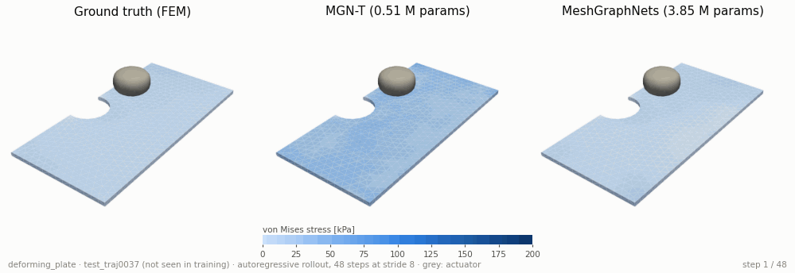
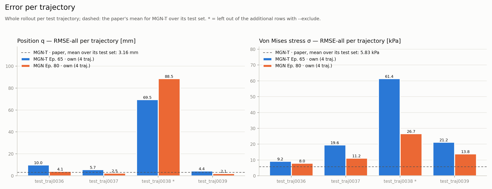
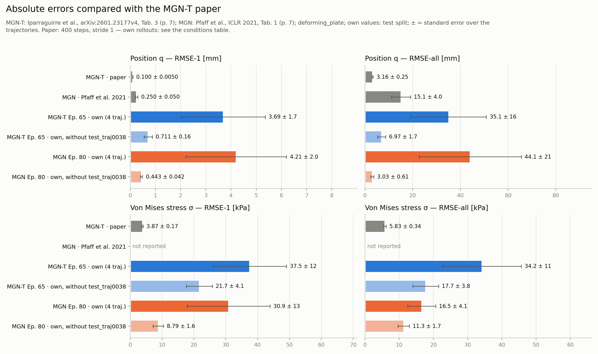
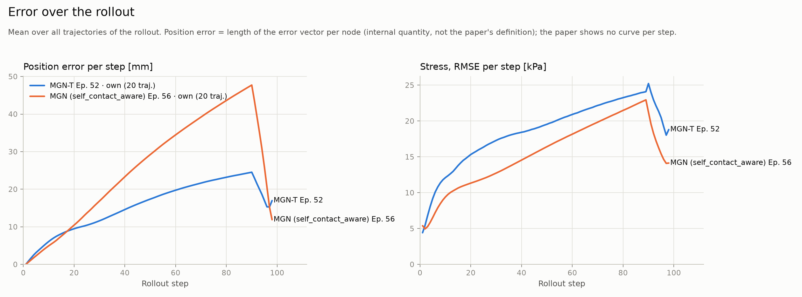

# First results (v0.3.0, preliminary)

This page documents the comparison of the two architectures in CrashDefNet,
**MeshGraphNets (MGN)** and **MeshGraphNet-Transformer (MGN-T)**, on DeepMind's
`deforming_plate` benchmark, and relates the numbers to the values published in the
papers. The runs were deliberately small (a reduced dataset and a single GPU for a few
hours). Both models share the data, seed, training budget and recipe of the
[comparison protocol](comparison-protocol.md). Each model is in the configuration of its paper: MeshGraphNets as the
protocol's baseline, MGN-T as in arXiv v4 ([configuration](#mgn-t-configuration)). The
runs show that the full pipeline works end to end and how the two architectures behave. They are **not** a reproduction of the papers' numbers.



*Autoregressive rollout of test trajectory 37 (a geometry the models never saw during
training). Colour: von Mises stress, same scale in all three panels. Grey: the actuator,
whose motion is prescribed. Made with
[`utils/animate_rollout.py`](../utils/animate_rollout.py) (see [Reproducing](#reproducing)).*

## Setup

| | MGN-T (paper configuration) | MeshGraphNets (baseline) |
|---|---|---|
| Architecture | 2 + 2 message passing steps, 2 transformer blocks over the plate nodes, 16 physics tokens, widths 80 / 48 ([configuration](#mgn-t-configuration)) | 15 message passing steps, latent 128 (paper size) |
| Contact edges | between bodies and for self-contact (`self_contact_aware`, paper v4) | all node pairs within the contact radius (`all`, paper) |
| Parameters | **0.51 M** | 3.85 M |
| Data | 40 trajectories of `test.tfrecord`, split 28 / 8 / 4 (train / val / test), 50 frames per trajectory at stride 8 | same |
| Training | batch 2, early stopping after 105 of 120 epochs, **1 h 09 min** (~40 s per epoch) | batch 2, ended after 93 of 120 epochs, 3 h 41 min (~2 min 20 s per epoch) |
| Hardware | 1× NVIDIA RTX A4000 (16 GB) | same |
| Evaluated checkpoint | epoch 65 (selected model) | epoch 80 (best by rollout MSE) |
| Model selection | val loss and the three rollout errors on the val split (the default criteria) | rollout MSE on the val split |
| Rollout | 48 autoregressive steps over the whole load case (loading and unloading), 4 unseen test geometries | same |

The trajectories come from DeepMind's test file, used for reasons of size (100
trajectories in 0.8 GB instead of 1,000 in 9.9 GB for the training file). Both models
share the same dataset, seed (42), normalization, noise (σ = 3·10⁻³ m on the positions
of free nodes), budget (120 epochs at batch 2), learning-rate schedule (1e-4 → 1e-6,
exponential) and validation; architecture and contact edges follow each paper.

## MGN-T configuration

MGN-T is trained in the configuration of its paper (Iparraguirre et al., arXiv v4,
Sec. 3 and 5.1): local message passing (2 steps), a global transformer stage
(2 blocks, 4 heads, 16 physics tokens), local message passing again (2 steps), two-layer
MLPs, contact edges for collision and self-contact (`world_edges =
"self_contact_aware"`) and a global stage over the simulated structure only
(`transformer_nodes = "structure"`). The actuator thus acts on the plate through
contact, and the plate passes the load on through its material.

Values the paper leaves open are set as follows; the implementation's general
assumptions are listed in [models](models.md#assumptions-where-the-paper-leaves-gaps):

| Setting | Value | Why |
|---|---|---|
| Latent / token width | 80 / 48, 0.51 M parameters | v4 gives the model size (~0.5 M parameters, Tab. 2) but no widths; with this implementation 80 / 48 gives that size (the widths 64 / 32 of v3 give 0.32 M) |
| Initial temperature | τ₀ = 1.0 (`tau_init = 0.31`) | the paper's τ₀; the implementation keeps τ positive with softplus, so `tau_init` = 1 − ln 2 starts at τ = 1.0 |
| Positional encoding | 4 frequencies (`pe_frequencies`) | waves with 1, 2, 4 and 8 periods over the plate; not given in the paper |
| Feed-forward width | 4 × token width (`ffn_ratio`) | the standard transformer value; not given in the paper |

The training recipe is the protocol's, the same as for the baseline: batch 2 and
120 epochs (82,320 optimizer steps). The paper's recipe (25 epochs at batch 32) would
give about 1,100 optimizer steps on the 28 training trajectories here (see the
conditions [below](#why-the-numbers-are-not-comparable-with-the-paper)).

## Metrics

The metrics follow the MGN-T paper (arXiv v4, App. A on p. 12) and are computed by
[`predict/rollout.py`](../predict/rollout.py); the comparison with the paper is
produced by [`utils/compare_paper.py`](../utils/compare_paper.py).

- **q**: node position (m), **σ**: von Mises stress (Pa)
- **RMSE-all**: RMSE over the whole rollout (all nodes, components, steps and trajectories)
- **RMSE-1**: one step from the ground-truth state
- **±**: standard error over the test trajectories

## Results

| Model | Params | q RMSE-all [mm] | σ RMSE-all [kPa] | q RMSE-1 [mm] | σ RMSE-1 [kPa] |
|---|---|---|---|---|---|
| MGN-T · own (4 test traj.) | 0.51 M | **35.1 ± 16** | 34.2 ± 11 | **3.69 ± 1.7** | 37.5 ± 12 |
| MeshGraphNets · own (4 test traj.) | 3.85 M | 44.1 ± 21 | **16.5 ± 4.1** | 4.21 ± 2.0 | **30.9 ± 13** |
| MGN-T · own, without traj. 38 | 0.51 M | 6.97 ± 1.7 | 17.7 ± 3.8 | 0.711 ± 0.16 | 21.7 ± 4.1 |
| MeshGraphNets · own, without traj. 38 | 3.85 M | **3.03 ± 0.61** | **11.3 ± 1.7** | **0.443 ± 0.042** | **8.79 ± 1.6** |
| *MGN-T · paper (Tab. 3)* | *0.5 M* | *3.16 ± 0.25* | *5.83 ± 0.34* | *0.100 ± 0.005* | *3.87 ± 0.17* |
| *MGN · Pfaff et al. 2021 (Tab. 1)* | *2.0 M* | *15.1 ± 4.0* | *–* | *0.25 ± 0.05* | *–* |

Reference rows: MGN-T from Iparraguirre et al. (arXiv v4, Tab. 3 on p. 7), MGN from
Pfaff et al. (ICLR 2021, Tab. 1 on p. 7; ± over its 100 test trajectories, App. A.5.2).
The MGN-T paper repeats the MGN values without ± in Tab. 2 on p. 7. The parameter
count of MGN is given only by the MGN-T paper (Tab. 2).



### What the numbers show

- **Efficiency.** MGN-T has **7.5× fewer parameters** than MeshGraphNets and needs
  **about 3.5× less training time per epoch** (1 h 09 min in total instead of 3 h 41 min).
- **Per test geometry.** Paired as in the protocol, MeshGraphNets has the lower stress
  error on all four test geometries, an established difference by the protocol's rule,
  and the lower position error on three of the four; MGN-T has the lower position error
  on trajectory 38.
- **Typical geometries.** Without trajectory 38, MeshGraphNets is more accurate in
  position (3.03 vs 6.97 mm) and in stress (11.3 vs 17.7 kPa). On trajectory 37, shown
  in the animation above, MGN-T deflects the plate further than the FEM (by up to
  24 mm) and keeps higher stresses through the unloading.
- **Outlier: test trajectory 38.** Its largest node displacement is 490 mm. That is
  more than in any of the 28 training trajectories (maximum 301 mm, median 76 mm),
  so both models have to extrapolate. This one trajectory dominates the mean over
  all four. On it MGN-T has the lower position error (70 vs 89 mm), MeshGraphNets the
  lower stress error (26.7 vs 61.4 kPa). The rows "without traj. 38" are therefore
  listed separately, pooled like the paper.

### Further figures

All metrics next to the paper's values (bars: mean, whiskers: standard error over the
test trajectories):



Error over the rollout, averaged over the four test trajectories. Both curves are
dominated by trajectory 38; the drop at the end is the unloading phase, where the plate
springs back:



### Why the numbers are not comparable with the paper

| | Paper | Own runs |
|---|---|---|
| Training data | number of trajectories not stated (DeepMind's training split holds 1,000) | 28 trajectories |
| Time step | stride 1, 400 rollout steps | stride 8, 48 rollout steps |
| MGN-T configuration | arXiv v4 | arXiv v4; open values as [above](#mgn-t-configuration) |
| Training | MGN-T: 25 epochs, batch 32 (arXiv v4, Sec. 5.1); ~8 h on an RTX 4090 (v3) | MGN-T: 105 epochs, batch 2, 1 h 09 min on an RTX A4000 |
| Test set | size not stated | 4 trajectories |

- **RMSE-1** is not comparable: at stride 8 the nodes move about eight times as far
  per step as in the paper.
- **RMSE-all** covers the same physical time span, but with fewer steps, which means
  fewer chances for errors to accumulate. The row "MeshGraphNets without traj. 38"
  (3.03 mm) is below the paper's MGN-T value (3.16 mm). That is **not** a better
  result, only a consequence of these different conditions.

## Discussion

In this setup MeshGraphNets reproduces the deformation better, though not on every test
geometry. Hybrid architectures such as MGN-T aim at very large meshes, on which pure
message passing needs many steps to carry information through the structure; a subset
of small plates with 28 training trajectories cannot show this. The public plate dataset
nevertheless suits the development of such methods: its geometries vary strongly, and at
stride 8 it has few time steps, as real crash data often do.

A scientific evaluation of the results is planned for later releases of CrashDefNet and
will be published separately, as a paper or in another form.

## Next steps

- Train on the full training split (`train.tfrecord`, 1,000 trajectories) at stride 1,
  as in the paper, using lazy loading (`[data] lazy = true`)
- Evaluate on a larger test set, with several seeds per architecture

## Reproducing

```bash
# 1) Dataset (~10 s, ~48 MB)
python -m dataset_preprocessor.export --out-dir data/deforming_plate_s8_t40 \
    --n-train 28 --n-val 8 --n-test 4 --num-steps 50 --time-stride 8

# 2) Training (GPU): copies of the protocol config with early stopping as below; for
#    MGN-T also [model] and the criteria as shown below
python train/train.py --config configs/<mgn run>.toml
python train/train.py --config configs/<mgn_t run>.toml

# 3) Rollouts of the selected models on the test split
python predict/rollout.py --checkpoint checkpoints/<mgn_t run>/best_model.pt \
    --data-dir data/deforming_plate_s8_t40 --split test
python predict/rollout.py --checkpoint checkpoints/<mgn run>/best_model.pt \
    --data-dir data/deforming_plate_s8_t40 --split test

# 4) Protocol check and comparison with the paper (figures, tables, report in evaluations/)
python utils/check_protocol.py rollouts/<mgn rollout> rollouts/<mgn_t rollout> \
    --exclude test_traj0038
python utils/compare_paper.py rollouts/<mgn_t rollout> rollouts/<mgn rollout> \
    --exclude test_traj0038

# 5) Animation of test trajectory 37 (the GIF at the top, ~20 s on a CPU)
python utils/animate_rollout.py rollouts/<mgn_t rollout> rollouts/<mgn rollout> \
    --trajectory test_traj0037
```

Both runs of these results trained with early stopping (`patience = 8`,
`min_epochs = 50`); the MGN-T config also differs from the protocol config in `[model]`,
the selection criteria and the machine settings:

```toml
[model]
architecture            = "mgn_t"
residual_target         = false
world_edges             = "self_contact_aware"
world_edge_exclude_hops = 4

[model.mgn_t]
latent_size            = 80
token_dim              = 48
num_tokens             = 16
num_heads              = 4
num_transformer_blocks = 2
num_pre_mp_steps       = 2
num_post_mp_steps      = 2
num_mlp_layers         = 2
aggregation            = "sum"
transformer_nodes      = "structure"
tau_init               = 0.31
pe_frequencies         = 4
ffn_ratio              = 4

[training.early_stopping]
enabled    = true
patience   = 8
min_epochs = 50
criteria   = ["val_loss", "rollout_mse", "rollout_pos_rmse", "rollout_pos_rmse_final"]
```

Each rollout folder contains `rollout_info.json` with the SHA-256 of the checkpoint, the
identity of the dataset (content fingerprint, for exports before format v4 the SHA-256
of the file), the training config with its source TOML file, the command line and the
git commit. That makes every number traceable to its inputs.
