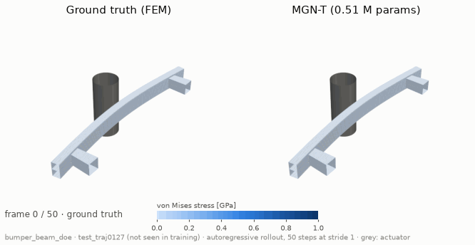
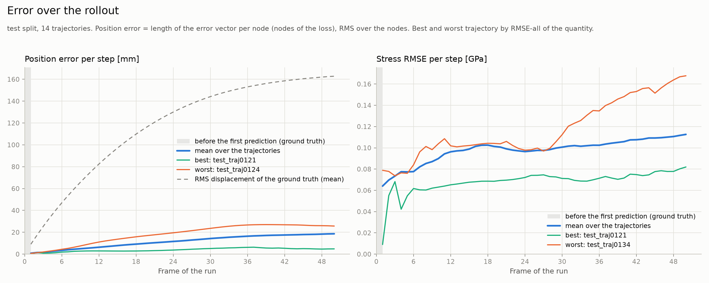

# Bumper beam design of experiments

MGN-T on a design of experiments of the [bumper beam](bumper-beam.md): 135 OpenRadioss runs in
which the geometry, the impact velocity, the shell thickness and the position of the pole vary.
The model predicts the whole impact autoregressively from the undeformed state, 50 steps of
2 ms, each state from its own previous prediction, with the contact to the pole and the
self-contact of the structure rebuilt from the predicted geometry at every step, together with
the von Mises, membrane and bending stress and the plastic strain. The design of experiments
is that of Akhare et al. (2026), so the results stand next to theirs
([comparison](#comparison-with-akhare-et-al)).



*Autoregressive rollout of test run 127 (`run4` of the dataset: geometry as designed, 5 m/s,
thickness × 0.7, pole at y = 0), the test run at the median of the position error, from 0 to
100 ms. Its combination of geometry, velocity, thickness and pole position did not occur in
training. Colour: von Mises stress, same scale in both panels. Grey: the pole.*

## Data

[OpenRadioss-BumperBeam-DoE135](https://huggingface.co/datasets/stofe94/OpenRadioss-BumperBeam-DoE135)
on Hugging Face: the model of the [bumper beam results](bumper-beam.md#data) (decks
"Copyright Altair Engineering, CC BY-NC 4.0"), computed with OpenRadioss over the design of
experiments of the OpenRadioss recipe in NVIDIA PhysicsNeMo. The dataset card describes the
generation.

| | |
|---|---|
| Varied, full factorial | geometry scaled by (sx, sy, sz) = (1, 1, 1), (1, 0.5, 1), (1, 1, 0.5), (1, 2, 1), (1, 1, 2); impact at 3, 5 or 7 m/s; thickness of all shells × 0.7, 1.0 or 1.3; pole at y = 0, 120 or 240 mm |
| Load case | 51 states at 2 ms, 0 to 100 ms |
| Mesh | 13,832 nodes of the structure and 4,880 of the meshed pole, the same in every run |
| Splits | 108 / 13 / 14 runs, random with seed 42, as in the dataset |

The solver computes the impact against an analytic cylinder.
[`utils/remesh_pole.py`](../guides/openradioss.md#a-pole-as-contact-partner) inserts it as a
mesh at the position of each run, so that the pole acts on the structure through contact edges.

## Setup

| | MGN-T |
|---|---|
| Architecture | as arXiv v4, 0.51 M parameters ([configuration](deforming-plate.md#mgn-t-configuration)); transformer over the structure, without the pole (`transformer_nodes = "structure"`) |
| Contact edges | between bodies and for self-contact (`self_contact_aware`), radius 20 mm; each with the distance from the shell surface of the sender and the clearance between the shell surfaces ([contact gap](../concepts/graphs.md#general-meshes-and-run-parameters)) |
| Inputs per node | node type, prescribed velocity, previous velocity and result fields, shell thickness and yield stress from the starter deck, distance to the [cylinder of the deck](../guides/openradioss.md#a-pole-as-contact-partner) and its normal, with markers for nodes without a result field, thickness or yield stress |
| Inputs per mesh edge | besides the geometry, thickness and yield stress of the elements next to the edge |
| Targets | change of velocity, von Mises stress, plastic strain, membrane mean stress and bending stress from one state to the next (`residual_target`) |
| Loss | MSE of the targets, plus the length change of the mesh edges in a step and the velocity of the rigid body, each against the simulation, with weight 1 ([loss](../concepts/training.md#loss-and-optimizer-step)) |
| Frames | training and rollout from the undeformed state at 0 ms |
| Training | 25 epochs, batch 2, learning rate 2 · 10⁻⁴ to 10⁻⁶ (cosine), noise 0.05 mm and 5 MPa, scheduled sampling over 3 steps, seed 42; **7 h 18 min** |
| Hardware | 1× NVIDIA RTX A4000 (16 GB); GPU 5.3 GB, RAM 11.8 GB in the main process |
| Model selection | rollouts of the 13 validation runs after every epoch, by the position error over the rollout and at its last step; epoch 25, the last |
| Rollout | 50 autoregressive steps from 0 to 100 ms, 14 test runs |

With scheduled sampling over 3 steps, a growing share of the samples takes its inputs from the
model's own rollout over the 3 states before instead of from the simulation: none at the start,
70 % after 12 of the 25 epochs
([training](../concepts/training.md#one-step-training)).

## Results

Test split, 14 runs ([metrics](../concepts/metrics.md#rollout-metrics)):

| Metric | All (pooled) | Median | Best | Worst |
|---|---|---|---|---|
| Position RMSE-1 [mm] | 0.241 ± 0.021 | 0.209 | 0.127 | 0.446 |
| Position RMSE-all [mm] | **6.76 ± 0.58** | 6.12 | 2.09 | 10.0 |
| Position error / displacement [%] | 9.46 | 7.77 | 5.46 | 68.2 |
| Position rel. L2 [×10⁻³] | 23.7 | 18.1 | 6.18 | 57.8 |
| Stress RMSE-1 [MPa] | 26.1 ± 1.0 | 26.0 | 19.6 | 32.0 |
| Stress RMSE-all [MPa] | 99.9 ± 3.5 | 102 | 69.1 | 120 |
| Stress R-RMSE-all [%] | **11.9 ± 0.4** | 11.9 | 9.22 | 14.1 |

Position error / displacement: the position error as a share of the displacement of the
ground truth since the initial state
([internal metrics](../concepts/metrics.md#internal-metrics)). Position rel. L2: the metric of
the comparison below
([relative L2 position error](../concepts/metrics.md#relative-l2-position-error)).



*Position error and stress RMSE per frame over the 14 test runs: mean, best and worst run;
dashed: the displacement of the ground truth.*

## Comparison with Akhare et al.

[Akhare et al. (2026)](https://arxiv.org/abs/2605.27758) use the same design of experiments
(Sec. 5.1: the same five factors and levels, 135 runs, split 80 / 10 / 10 %) and report the
relative L2 error of the positions on their test runs (Table 3). CrashDefNet computes the same
metric on its test runs:

| Test, position rel. L2, mean over the 50 steps | ×10⁻³ |
|---|---|
| Transolver, Adam / Muon | 9.37 / 9.12 |
| GeoTransolver, Adam / Muon | 9.40 / 7.32 |
| GeoTransolver with FLARE, Adam / Muon | 8.37 / 6.80 |
| CrashDefNet, MGN-T | 23.7 |

How the two set-ups differ:

- **Time:** CrashDefNet predicts step by step from the undeformed state, each state from its
  own previous prediction ([why autoregressive](../concepts/overview.md#why-autoregressive)).
  Akhare et al. compare time schemes on this dataset (Sec. 6.1):
  one-shot and time-conditional prediction map the initial state to the later states directly;
  the autoregressive rollout over the 50 steps is reported as unstable (Table 2).
- **Outputs:** there the positions; here positions, von Mises, membrane and bending stress
  and plastic strain, with the contact to the pole and the self-contact taken from the
  predicted geometry at every step.
- **Test runs:** both 10 % of the 135 runs; the assignment of Akhare et al. is not published.
- **Nodes:** here every node of the structure and of the rigid body, without the pole.
- **Data:** the runs here are computed independently from the published recipe; the
  dataset card lists where they differ from it.

## Discussion

Over the whole impact, 50 steps from the undeformed state, the model carries the deformation
on its own predictions in every test run: the position error stays below the displacement in
all 14 runs, at a median of 8 % of it, and the stress error at 9 to 14 % of the largest
stress of the run.

A scientific evaluation of the results is planned for later releases of CrashDefNet and will be
published separately, as a paper or in another form.

## Reproducing

About 43 GB of disk space: the dataset 16 GB (6.5 GB to download, one zip per run, unpacked
and deleted by the second command), with the meshed pole 22 GB, the export 3.7 GB,
checkpoints and rollout 1.6 GB. `huggingface_hub` for the download
(`pip install huggingface_hub`).

```bash
hf download stofe94/OpenRadioss-BumperBeam-DoE135 --repo-type dataset \
    --local-dir datasets/OpenRadioss-BumperBeam-DoE135
python -c "import pathlib, shutil; [(shutil.unpack_archive(z, z.parent), z.unlink()) for z in pathlib.Path('datasets/OpenRadioss-BumperBeam-DoE135/RAW_DATA').glob('*/run*.zip')]"
python utils/remesh_pole.py --raw-dir datasets/OpenRadioss-BumperBeam-DoE135/RAW_DATA \
    --sources TRAIN VAL TEST --half-height 300 --contact-radius 20 \
    --out-dir datasets/OpenRadioss-BumperBeam-DoE135_remeshed/RAW_DATA
python -m dataset_preprocessor.export --config examples/bumper_beam_doe/export.toml
python train/train.py --config examples/bumper_beam_doe/train.toml
python predict/rollout.py --config examples/bumper_beam_doe/rollout.toml
```

The configs in `examples/bumper_beam_doe/` hold the settings of the run above; the rollout
evaluates it on the test split and renders the animation of the run at the median. The
[bumper beam tutorial](../getting-started/bumper-beam.md) explains each step on the smaller
dataset.

Trained and rolled out with the development state of v1.1.0.
