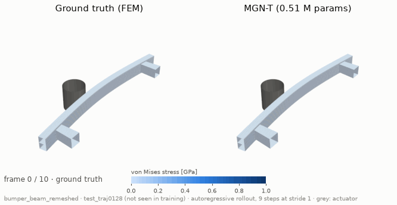
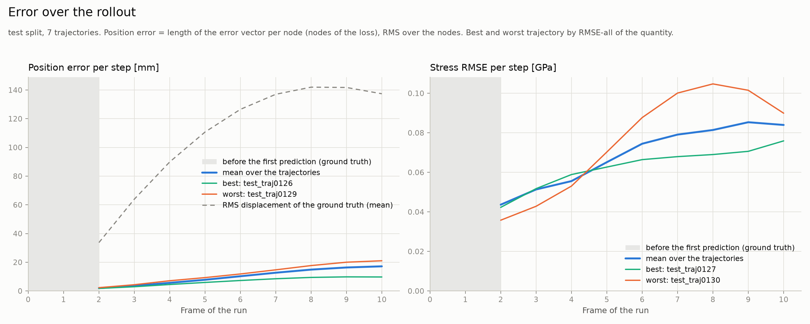

# Bumper beam against a pole

MGN-T on a real crash case: OpenRadioss runs of a bumper beam that hits a rigid pole. The model
predicts the impact autoregressively, each state from its own previous prediction, with the
contact to the pole and the self-contact of the structure rebuilt from the predicted geometry at
every step. The runs are read as d3plot files with their OpenRadioss starter decks, only the
display of the pole replaced by a mesh, and pass through every stage of CrashDefNet: reader and
starter deck, export config with the roles of the parts, a free rigid body, contact edges to
the pole, units in mm and GPa and features that some nodes do not have.

*Autoregressive rollout of test run 128, the test run at the median of the position error, from
10 to 100 ms. Its beam thickness and pole position did not occur in training. Colour: von Mises
stress, same scale in both panels. Grey: the pole.*

## Data

[BumperBeamCrashExample](https://huggingface.co/datasets/AIRBORNEPANDA/BumperBeamCrashExample)
on Hugging Face, generated with
[OpenRadioss2PhysicsNemo](https://github.com/HoussemMouradi/OpenRadioss2PhysicsNemo); the decks
of the runs carry the notice "Copyright Altair Engineering, CC BY-NC 4.0".

| | |
|---|---|
| Model | bumper beam with two crash boxes, shell parts joined by spot welds, on a rigid body of 500 kg; rigid cylindrical pole of 254 mm diameter |
| Load case | impact at 5 m/s; 11 states at 10 ms, 0 to 100 ms |
| Varied | thickness of the beam, 1.21 to 2.0 mm (crash boxes 2.2 mm), and position of the pole across the beam, −480 to 492 mm |
| Mesh | 13,832 nodes of the structure and 2,320 of the meshed pole, the same in every run |
| Splits | 110 / 14 / 7 runs: training and validation from `TRAINING_DATA`, test = `VALIDATION_DATA` of the dataset |

The solver computes the impact against an analytic cylinder.
[`utils/remesh_pole.py`](../guides/openradioss.md#a-pole-as-contact-partner) meshes it at the same place, so
that the pole acts on the structure through contact edges; all other nodes and results stay
identical.

## Setup

| | MGN-T |
|---|---|
| Architecture | as arXiv v4, 0.51 M parameters ([configuration](deforming-plate.md#mgn-t-configuration)); transformer over the structure, without the pole (`transformer_nodes = "structure"`) |
| Contact edges | between bodies and for self-contact (`self_contact_aware`), radius 30 mm |
| Inputs per node | node type, prescribed velocity, previous velocity and stress, shell thickness from the starter deck, with markers for nodes without stress or thickness |
| Targets | change of velocity and stress from one state to the next (`residual_target`) |
| Frames | training and rollout from 10 ms (`[data] start_frame = 1`) |
| Training | 80 epochs, batch 4, learning rate 2.8 · 10⁻⁴ to 10⁻⁶ (cosine), noise 0.3 mm and 10 MPa, scheduled sampling, seed 42; **3 h 18 min** |
| Hardware | 1× NVIDIA RTX A4000 (16 GB); GPU 7.3 GB, RAM 4.6 GB in the main process |
| Model selection | rollout MSE on the 14 validation runs, every 4 epochs; epoch 40 |
| Rollout | 9 autoregressive steps from 10 to 100 ms, 7 test runs |

The training data leave out the first frame on purpose: the step from the undeformed state to
the first deformed state, in which the beam hits the pole, is too large to be resolved with the
current physical modelling.

With scheduled sampling a growing share of the nodes takes its previous velocity and stress
from the model's own prediction of the step before, as in the rollout, instead of from the
simulation: from none of the nodes at the start to 70 % after 40 of the 80 epochs
([training](../concepts/training.md#loss-and-optimizer-step)).

## Results

Test split, 7 runs ([metrics](../concepts/metrics.md#rollout-metrics)):

| Metric | All (pooled) | Median | Best | Worst |
|---|---|---|---|---|
| Position RMSE-1 [mm] | 0.876 ± 0.064 | 0.850 | 0.627 | 1.07 |
| Position RMSE-all [mm] | **6.19 ± 0.47** | 6.25 | 3.87 | 7.29 |
| Position error / displacement [%] | 10.0 | 9.78 | 6.75 | 12.8 |
| Position rel. L2 [×10⁻³] | 16.1 | 16.6 | 10.7 | 19.3 |
| Stress RMSE-1 [MPa] | 33.7 ± 1.2 | 34.2 | 27.6 | 38.1 |
| Stress RMSE-all [MPa] | 70.8 ± 2.3 | 69.5 | 63.6 | 80.2 |
| Stress R-RMSE-all [%] | **8.55 ± 0.27** | 8.34 | 7.74 | 9.51 |

Position error / displacement: the position error as a share of the displacement of the
ground truth since the initial state
([internal metrics](../concepts/metrics.md#internal-metrics)). Position rel. L2: as in the
crash studies of Nabian et al. and Akhare et al., on the coordinates of the dataset
([relative L2 position error](../concepts/metrics.md#relative-l2-position-error)).

*Position error and stress RMSE per frame over the 7 test runs; dashed: the displacement of the
ground truth; grey: before the first prediction.*

## Discussion

Over the whole impact the model carries the deformation on its own predictions: the position
error stays at about a tenth of the displacement in every test run, and the stress error at
8 to 10 % of the largest stress of the run, with little spread between the runs. The surface of
the structure stays smooth over the whole impact, close to the simulation. The results show
that the chain from OpenRadioss runs to the trained model works on a real crash example; the
processing of such data is at an early stage of development
([verification status](../concepts/graphs.md#general-meshes-and-run-parameters)).

A scientific evaluation of the results is planned for later releases of CrashDefNet and will be
published separately, as a paper or in another form.

Rolled out with release v1.0.0. How to run it: [tutorial](../getting-started/bumper-beam.md).
